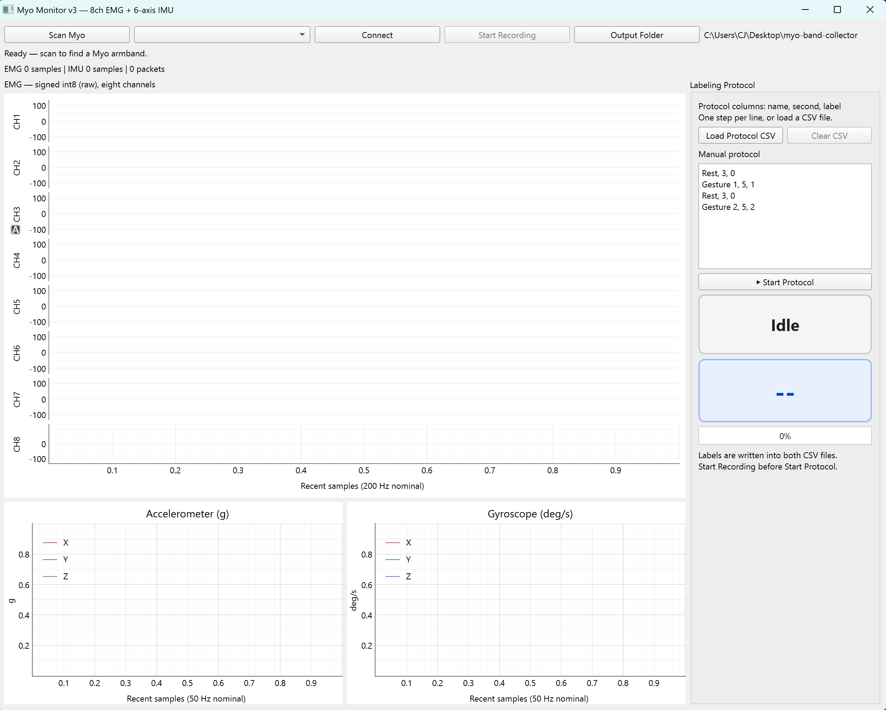

## Dongle-less Myo app

This app is for the EMG collection with dongle-less MyoArmband from [`Thalmic Labs`](https://github.com/thalmiclabs). MyoArm band is no longer manufatured and many user or researcher lost its dongle to connect. This app is for who lost dongle but still needs MyoArmband.

Thanks to [`Thalmic Labs`](https://github.com/thalmiclabs), They archive the code and documents for the bluetooth protocol at [`Myo Official Bluetooth`](https://github.com/thalmiclabs/myo-bluetooth). Also, thanks to [`@iomz`](https://github.com/iomz) devloped the [`dl-myo`](https://github.com/iomz/dl-myo) python packages for the dongle-less MyoArmband users. We referenced these two repositories and developed the Myo visualizer and data collector.

This codes are just for the user who needs simple visualizer and data collector. Please install required packages and execute the main python file, and you can see the simple data visualizer and collection app. Using this app, you can easily connect the device, visualize the collected EMG and IMU data. Also, if you need label, you can set the own protocol and auto-label by the duration you set. 

  
  
<em>Figure 1. Dongle-less myo app.</em>

### Kudos
- [`@Thalmic Labs`](https://github.com/thalmiclabs)
- [`@iomz`](https://github.com/iomz) (Iori Mizutani)
- [`@JEONGSE0`](https://github.com/JEONGSE0) (Jeongseo Jang)

### Acknowledgments

This project was developed with reference to:

- [dl-myo](https://github.com/iomz/dl-myo)
  - Dongle-less BLE communication with the Myo Armband.
- [Myo Bluetooth Protocol](https://github.com/thalmiclabs/myo-bluetooth)
  - Official BLE protocol specification by Thalmic Labs.

### License

This project is licensed under the MIT License.
See the LICENSE file for details.
